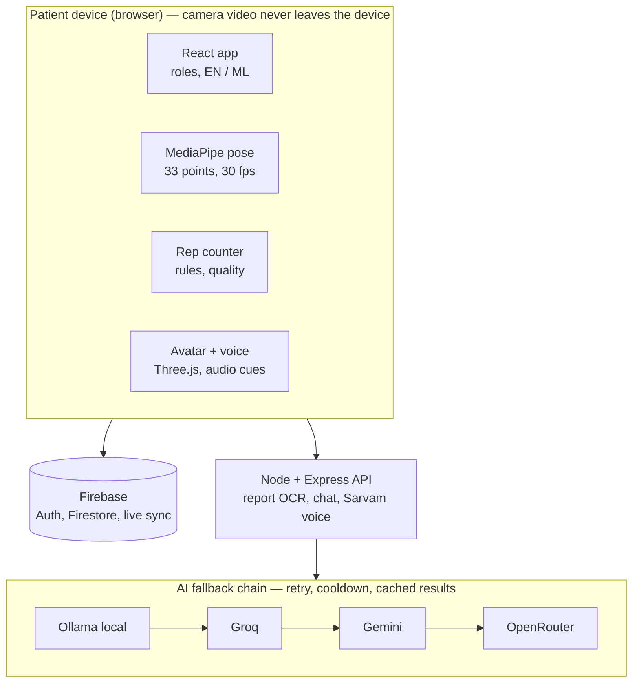

# Revive — AI Avatar-Guided Home Physiotherapy

**She Builds Tech 3.0 · KSUM 2026**

Revive is a physiotherapist at home that speaks Malayalam and keeps the family in the loop.
It reads the patient's medical report, suggests exercises for a physiotherapist to approve,
demonstrates them with a 3D avatar, watches the patient through a webcam (no wearables),
counts reps, corrects wrong posture in Malayalam, and lets a son or daughter monitor progress
remotely and download a report for the doctor.

---

## The problem

Elderly and recovering patients doing physiotherapy at home have no one to correct them.
They do exercises wrong, compensate for pain, lose motivation, and their family — often
working in another city — can't see whether they are improving.

## Key features

| Feature | What it does |
|---|---|
| MRI report analysis | Upload a report (PDF/photo) → AI extracts findings and suggests exercises from our library |
| Physiotherapist approval | A licensed physio approves, edits or rejects the AI plan before exercises unlock |
| 3D avatar | Demonstrates each exercise, with mirror mode, speed control and front/side view |
| Live pose tracking | MediaPipe tracks 33 body points at ~30 fps, entirely on the device |
| Rep counting + form check | Counts only full, correct reps; detects shrugging, leaning, knees caving in and more |
| Malayalam voice | Rep counting, corrections and instructions in Malayalam; voice questions to "Ask Revive" |
| Progress & analytics | Streak, quality trend, reps per day, pain before/after, per-exercise breakdown |
| Caregiver dashboard | Family links via invite code, sees live progress, 24-hour missed-session alert, PDF report |
| Bilingual UI | Full English / മലയാളം toggle |

## Architecture



## How it works

1. **Report analysis** — PDF text is extracted with pdf.js and images with Tesseract OCR, locally.
   The text goes to the AI with a strict JSON schema; it may only choose exercise IDs from our
   library. Results are cached by file hash.
2. **Human in the loop** — the AI only suggests. A physiotherapist approves or edits the plan.
3. **Joint angles** — for three landmarks A–B–C, the angle at B is
   `θ = arccos((BA · BC) / (|BA| |BC|))`.
4. **Rep counting** — a state machine `START → UP → TOP → DOWN → START`; a rep counts only when
   the target range of motion is reached and the limb returns to rest.
5. **Form correction** — a 1.5 s calibration records the patient's own posture; deviations
   (shrug > 20 %, trunk lean > 10°, knees caving in, etc.) must persist 250 ms before they count.
   A rep done with the main wrong movement is not counted.
6. **Quality score** — 40 points range of motion, 30 smoothness, 30 form.
7. **Malayalam voice** — cues are pre-generated with Sarvam AI and played instantly from files,
   so there are no API calls during exercise.
8. **Resilient AI** — local Ollama → Groq → Gemini → OpenRouter, with retry, backoff and cooldown.

## Tech stack

- **Frontend:** React, Vite, Tailwind CSS, React Router, react-i18next
- **Vision:** `@mediapipe/tasks-vision` (Pose Landmarker, WebAssembly)
- **3D:** three.js, @react-three/fiber, @react-three/drei
- **Backend:** Node.js, Express
- **Data:** Firebase Authentication, Cloud Firestore (real-time listeners + security rules)
- **AI:** Ollama (qwen2.5:3b), Groq, Google Gemini, OpenRouter, Sarvam AI (Malayalam TTS/STT)
- **Documents:** pdf.js, Tesseract.js, jsPDF

## Run locally

Requirements: Node.js 22+, a Firebase project, and API keys (all have free tiers).

```bash
git clone https://github.com/saniluttu/revive.git
cd revive

# Backend
cd server
cp .env.example .env      # fill in GEMINI / GROQ / OPENROUTER / SARVAM keys
npm install
npm run voice-cues        # one-time: generate Malayalam + English voice cues
npm run dev               # http://localhost:5000

# Frontend (new terminal)
cd client
cp .env.example .env      # fill in VITE_FIREBASE_* values
npm install
npm run seed              # optional: demo patient, caregiver and physiotherapist
npm run dev               # http://localhost:5173
```

Optional local model: install [Ollama](https://ollama.com), run `ollama pull qwen2.5:3b`,
and set `OLLAMA_URL` / `OLLAMA_MODEL` in `server/.env`.

Publish `firestore.rules` in the Firebase console (Firestore → Rules).

## Privacy & safety

- Camera video is processed on the device and never uploaded.
- Caregivers can only see patients who shared their invite code; patients can remove them anytime.
- Revive does not diagnose or prescribe. All AI suggestions require physiotherapist approval,
  and red-flag symptoms in chat trigger "stop and contact your doctor".
- Form thresholds are based on standard physiotherapy guidance and are not yet clinically validated.

## Roadmap

- Pilot with physiotherapists to validate thresholds and set per-patient targets
- Stricter anti-cheat counting (tempo, hold time, body stillness) — prototyped, being tuned
- More exercises and body parts (lower back, neck)
- Mobile app with background "Hey Revive" wake word
- Exercise and medicine reminders, prescription assistant

## Team

Built during She Builds Tech 3.0 at Kerala Startup Mission, Kalamassery.
